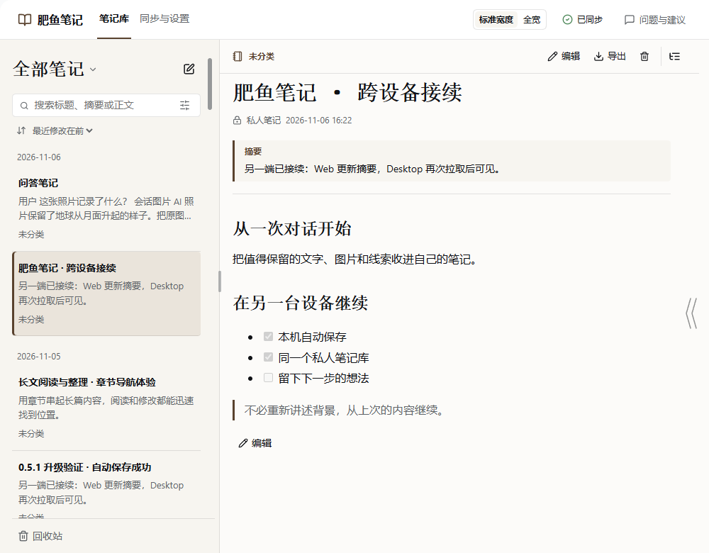

# Fatfish Notes · Private Note Management

[简体中文](README.md)

Save conversations, manage notes with images, export files, and sync across devices through your own private GitHub repository.



Version `0.6.0` is a release candidate, not a published release. It introduces the Fatfish Notes identity and includes chapter navigation and a native folder picker, alongside automatic saving and two-way sync.

## Features

- Save the current exchange, selected turns or messages, or a whole conversation. Keep the original conversation material separately from the editable note.
- Edit Markdown in place with live previews, headings, lists, code blocks, tables and images. Follow the host's light or dark appearance.
- Export notes or conversations as Markdown, ZIP with image attachments, PDF, a long image or paginated images.
- Keep a local copy and sync through a dedicated private GitHub repository. After the initial online setup, temporary offline edits are saved locally and sync resumes automatically.
- Optionally request title, summary and tag suggestions when saving a conversation. Note bodies are edited manually.

## Install

This guide covers the **0.6.0 candidate**. Supported host: **DSH 0.2.1-rc.5**. Verified on **Windows**; macOS has not been tested.

Check [GitHub Releases](https://github.com/StarWind97/dsh-fatfish-notes/releases) for publication status. After release, use `dsh-fatfish-notes-0.6.0.tgz`, not the automatically generated Source code archive. For now, the candidate is available locally to the developer. Start DSH once to initialize its profile, then quit it before installing:

```powershell
dsh plugin --profile desktop add "D:\Downloads\dsh-fatfish-notes-0.6.0.tgz"
```

Use the actual downloaded path. Web users should replace `desktop` with their profile name. If `dsh` is not on PATH, use `resources\runtime\cli\bin\dsh.cmd` inside the DSH installation directory. Restart DSH and open the notebook from the sidebar.

## First-time setup

1. Install **Git** and **GitHub CLI** if the setup screen reports them missing. It provides official download links and a recheck button. The plugin runs these tools for you; you do not need to learn Git commands.
2. Sign in to your own **GitHub account** through the browser. New users can create a private notebook, with `fatfish-notes` as the suggested name. On another computer, connect the notebook previously created by this plugin in the same account.
3. Use the suggested local folder or choose a parent directory in the system folder picker. The repository name is appended automatically. Confirm the cloud repository and final local path, then complete the first sync. Existing nonempty local folders and ordinary project repositories are not accepted for first-time setup.

Notes and archived images live on this computer and in your own private GitHub repository, not on the plugin author's servers. Cloud data is private by default. Tool installation and sign-in are separate from a successful first sync. Local changes made offline are not available on another device until they have synced.

If an already connected notebook needs GitHub authorization again, open **Sync and settings → Sync account**, sign in as the original account, and complete browser verification. The repository and local folder stay unchanged. A different account cannot sync this notebook.

## Upgrade, limitations and feedback

This rename uses a one-time developer data migration. The new package does not automatically load old plugin identities or old repository format markers. Historical 0.5.x packages keep their original names. For later upgrades under the new identity, confirm sync, quit DSH and back up both the notebook folder and `DSH_HOME/fatfish-notes` before installing the new package. See the [migration plan](docs/plans/2026-11-06-fatfish-notes-rename.zh.md).

Markdown file import and automatic attachment of a note to a conversation are not available in this version. Two isolated instances on one Windows computer have been tested; two physical computers and macOS still need real-device testing. Detailed [usage instructions](docs/user-guide.zh.md) and [verification records](docs/verification-log.zh.md) are available in Chinese.

Report problems through [Issues](https://github.com/StarWind97/dsh-fatfish-notes/issues), including OS, host/plugin versions and reproduction steps. Do not include credentials or private notebook contents.

Code is [MIT licensed](LICENSE). See [third-party and font notices](THIRD_PARTY_NOTICES.md). Screenshots show sample content in an isolated host.
