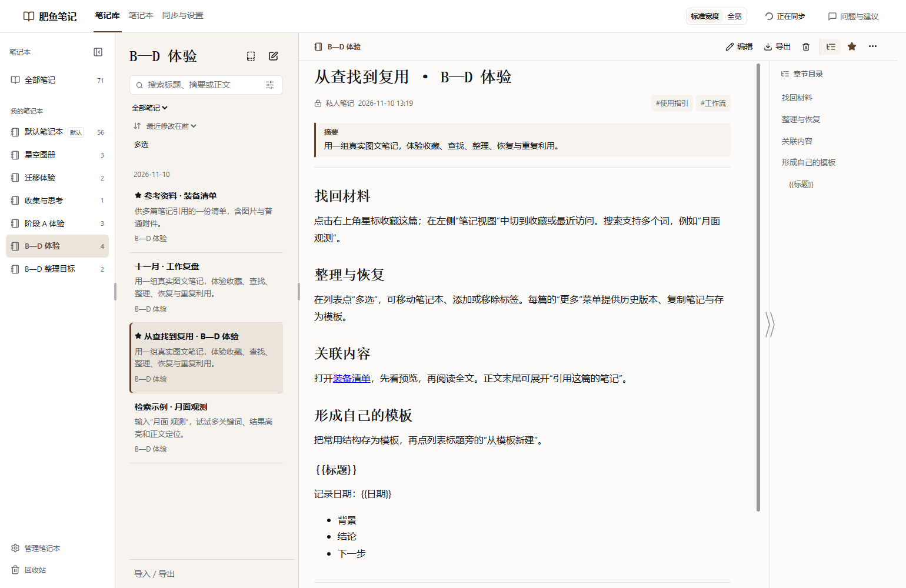

# Fatfish Notes · Private Note Management

[简体中文](README.md)

Save conversations, manage notes with images, export files, and sync across devices through your own private GitHub repository.



**0.8.0** adds a separate notebook window, adaptive three-column layout, favorites and search improvements, history recovery, batch organization, backlinks and templates, with faster reading and navigation. See the [release notes](docs/releases/0.8.0/release-notes.md) and [verification record](docs/releases/0.8.0/review.zh.md).

Current `main` contains the unreleased stage E implementation: a conversation sidebar, note links to sessions, selected uploaded/delivered files, references inserted into the conversation input, and background chunked imports. The public release remains 0.8.0; see the [stage E results](docs/plans/2026-11-11-stage-e-results.zh.md).

## Features

- Save the current exchange, selected turns or messages, or a whole conversation. Keep the original conversation material separately from the editable note.
- Edit Markdown in place with live previews, headings, lists, code blocks, tables and images. Follow the host's light or dark appearance.
- Open notes alongside DSH conversations in a separate window or use the adaptive three-column layout inside DSH. Hand off editing of the same note between windows.
- Find content with favorites, recent visits, multiword search and highlighted matches. Preview and restore revisions, organize notes in batches, follow backlinks and create notes from reusable templates.
- Export notes or conversations as Markdown, ZIP with image attachments, PDF, a long image or paginated images.
- Organize notes in notebooks with a default destination. Import Markdown files, folders or ZIP archives; export a notebook or the library as portable Markdown with relative image, attachment and note links.
- Save and download ordinary files including PDF, audio and video without inline preview or playback. In unreleased stage E, files over 50 MiB require confirmation and files over 100 MiB are rejected (the public 0.8.0 release uses 10/50 MiB).
- Link notes by stable identity, and select multiple notes for trash cleanup. Permanent deletion keeps files that other notes still reference.
- Keep a local copy and sync through a dedicated private GitHub repository. After the initial online setup, temporary offline edits are saved locally and sync resumes automatically.
- Optionally request title, summary and tag suggestions when saving a conversation. Note bodies are edited manually.

## Install

Current version: **0.8.0**. Supported host: **DSH 0.2.2-rc.1**. Verified on **Windows**; macOS has not been tested.

Download `dsh-fatfish-notes-0.8.0.tgz` from the [0.8.0 release page](https://github.com/StarWind97/dsh-fatfish-notes/releases/tag/v0.8.0), not the automatically generated Source code archive. Start DSH once to initialize its profile, then quit it before installing:

```powershell
dsh plugin --profile desktop add "D:\Downloads\dsh-fatfish-notes-0.8.0.tgz"
```

Use the actual downloaded path. Web users should replace `desktop` with their profile name. If `dsh` is not on PATH, use `resources\runtime\cli\bin\dsh.cmd` inside the DSH installation directory. Restart DSH and open the notebook from the sidebar.

## First-time setup

1. Install **Git** and **GitHub CLI** if the setup screen reports them missing. It provides official download links and a recheck button. The plugin runs these tools for you; you do not need to learn Git commands.
2. Sign in to your own **GitHub account** through the browser. New users can create a private notebook, with `fatfish-notes` as the suggested name. On another computer, connect the notebook previously created by this plugin in the same account.
3. Use the suggested local folder or choose a parent directory in the system folder picker. The repository name is appended automatically. Confirm the cloud repository and final local path, then complete the first sync. Existing nonempty local folders and ordinary project repositories are not accepted for first-time setup.

Notes and archived images live on this computer and in your own private GitHub repository, not on the plugin author's servers. Cloud data is private by default. Tool installation and sign-in are separate from a successful first sync. Local changes made offline are not available on another device until they have synced.

If an already connected notebook needs GitHub authorization again, open **Sync and settings → Sync account**, sign in as the original account, and complete browser verification. The repository and local folder stay unchanged. A different account cannot sync this notebook.

## Upgrade, limitations and feedback

Upgrade with the same installation command and the actual downloaded package path. An upgrade from 0.7.0 retains the existing binding and notes; no uninstall or setup reset is needed.

If you have content, confirm sync, close the separate notebook window and DSH, and back up the notebook folder and `DSH_HOME/fatfish-notes` before upgrading. Instances sharing one repository should upgrade together: old runtimes do not understand the new favorite/template revision fields, and a downgrade requires a matching backup. Historical 0.5.x identity migration is documented [separately](docs/plans/2026-11-06-fatfish-notes-rename.zh.md).

The separate window currently uses Chrome or Edge installed on Windows and relies on DSH staying open. Closing DSH pauses editing; restarting the same profile reconnects it. Favorites and templates sync through the private repository. Recent visits stay in the current browser and do not sync across windows or devices.

Import/export supports ordinary Markdown, basic properties, images, attachments and common Obsidian links, not third-party plugins, canvases or databases. Open an exported copy in Obsidian; do not share the plugin's internal data directory with another editor. Actual Obsidian verification used 1.10.6.

Automatic attachment of a note to a conversation is not available. Permanent deletion does not rewrite Git history or guarantee secure erasure. Two physical computers and macOS still need real-device testing. Detailed [usage instructions](docs/user-guide.zh.md) and [verification records](docs/verification-log.zh.md) are available in Chinese.

Report problems through [Issues](https://github.com/StarWind97/dsh-fatfish-notes/issues), including OS, host/plugin versions and reproduction steps. Do not include credentials or private notebook contents.

Code is [MIT licensed](LICENSE). See [third-party and font notices](THIRD_PARTY_NOTICES.md). Screenshots show sample content in an isolated host.
