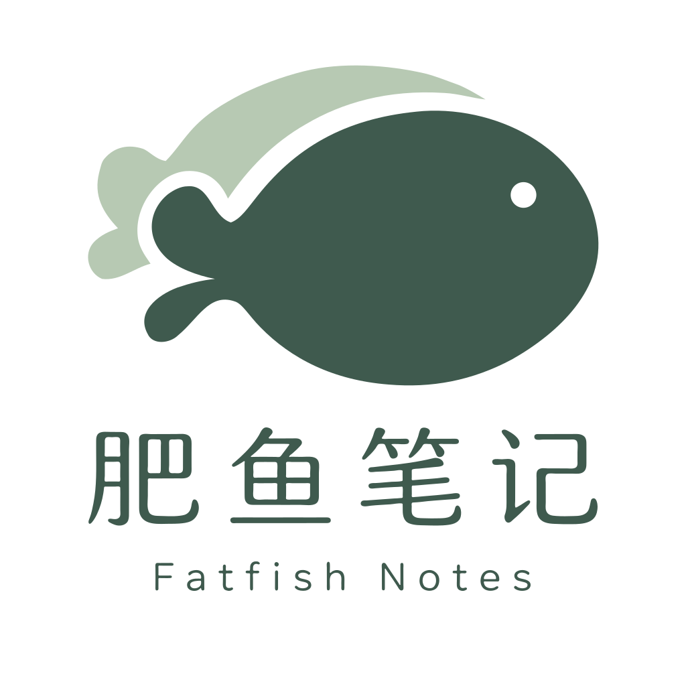
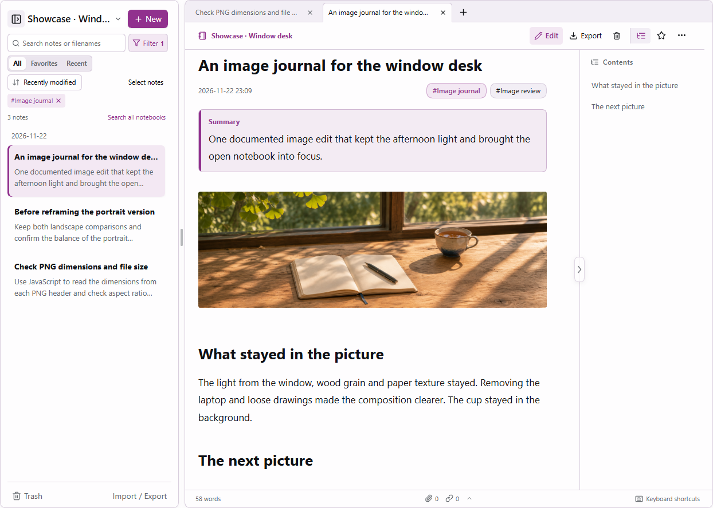
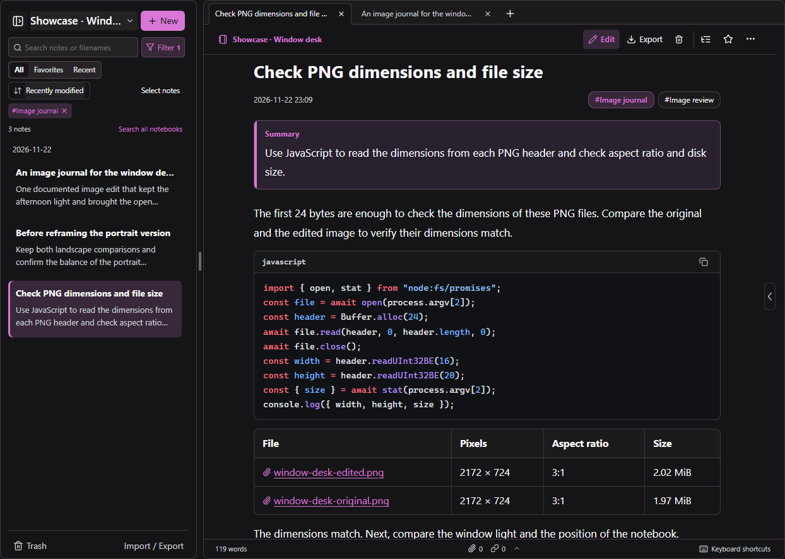
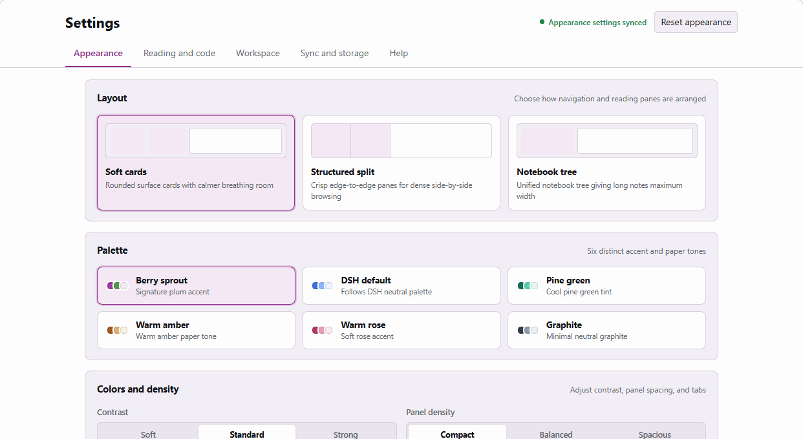

<p align="center">
  <picture>
    <source media="(prefers-color-scheme: dark)" srcset="assets/brand/fatfish-brand-transparent-dark.svg">
    
  </picture>
</p>

# Fatfish Notes · 肥鱼笔记

[简体中文](README.md)

Keep useful conversations as Markdown notes. Read, edit and reference them beside your chats, with local storage and sync through your own private GitHub repository.

> Fatfish Notes **0.13.0** declares support for DSH `>=0.2.2-rc.3 <0.2.3-0`. See the [release notes](docs/releases/0.13.0/release-notes.md) and [verification record](docs/releases/0.13.0/review.zh.md).



## From conversations to notes

- **Save a conversation**: Save a turn, selected messages or an entire conversation. Wide windows adapt to content height and show turns, live image thumbnails and files, and note details side by side. Start with the conversation title and optionally use the selected text to suggest a title, summary and tags. [Illustrated capture guide](docs/user-guide.en.md#save-a-conversation)
- **Use beside a conversation**: A unified top bar switches between the note list and reading view without vertical jump. Open linked notes or search the whole library, create, edit and link notes, or add reading instructions for a note copy to the composer for review before sending.
- **Write and organize in place**: Edit Markdown directly, expand the **Edit properties** drawer under the title when you want to adjust notebook, tags or summary, and paste or drop files. Standalone images display inline by default; mixed drops appear as download links, and images can switch modes anytime.
- **Unified search and quick switching**: Use the same search, filters and **All / Favorites / Recent** segmented control across the main view, separate window and sidebar. Press **Alt+K** (**⌥K** on macOS) in the main view or separate window to search titles, body text, attachment names, notebooks, tags and common actions in one place.
- **Organize your library**: Use **Organize → Tags** to preview affected notes before renaming, merging or removing a tag. Organize with favorites, pins, note links, bulk actions and version history. [Illustrated guide to tag management](docs/user-guide.en.md#organize-your-library)
- **Read your way**: Keep several notes open in reading tabs, drag to reorder, and use **+** to open the overview. Share three layouts (Soft cards, Structured split, Notebook tree), six distinct palettes (including Berry sprout), neutral charcoal dark surfaces, fonts and code highlighting between the main view and separate window. Empty outlines collapse automatically, and the sidebar follows DSH's light or dark theme.
- **Export for the job**: Export a single PNG using the reading layout (wide tables prompt you to widen the export instead of clipping columns), a PDF for reading or printing, or a Markdown bundle with original images and files.
- **Local-first with private sync**: Complete the three-step setup wizard once; afterward, save locally while offline and sync automatically when connected. Import Markdown files, folders or ZIPs, and export a notebook or the full library.


Keep code snippets, rounded tables, files and related notes together for the next time you need them.



## Installation and upgrade

Download the [latest stable plugin package, `dsh-fatfish-notes.tgz`](https://github.com/StarWind97/dsh-fatfish-notes/releases/latest/download/dsh-fatfish-notes.tgz). Versioned downloads and checksums are on the [0.13.0 release page](https://github.com/StarWind97/dsh-fatfish-notes/releases/tag/v0.13.0).

Start DSH once to initialize its profile, then quit it. Install a matching package using its actual path:

```powershell
dsh plugin --profile desktop add "D:\Downloads\dsh-fatfish-notes.tgz"
```

Web users should replace `desktop` with their profile name. If `dsh` is not on PATH, use `resources\runtime\cli\bin\dsh.cmd` inside the DSH installation directory. Restart DSH and open Fatfish Notes.

Users on 0.10.0–0.12.0 can install 0.13.0 into the same DSH profile and reopen DSH with their existing notes, private repository and edited handbooks intact; retired layouts and palettes (including pending sync queues) migrate automatically. Finish syncing, close DSH and the separate note window, and back up the local notebook folder and `DSH_HOME/fatfish-notes`. **When upgrading from 0.8.0, upgrade all instances sharing one repository together.** A downgrade needs a matching host and pre-upgrade backup. Existing templates and edited handbooks remain available as notes.

## Getting started

1. Let the three-step wizard check **Git** and **GitHub CLI**. Install missing tools using the official links, then recheck or restart DSH. The plugin runs these tools for you.
2. Sign in to your own **GitHub account**. Create a dedicated private library, or connect one previously created by this plugin on another computer.
3. Verify the repository and local folder, then complete the first sync. A new empty library includes a three-note handbook in the active DSH language. In an existing library, use **Settings → Help** to open or add the handbook in that language.

Notes and archived resources live on your computer and in your private repository, not on the plugin author's servers. Initial setup requires a connection; local save and cloud sync are tracked separately afterward.

Editing saves automatically. Work in the main page, sidebar or a separate window, with editing handoff when two views open the same note. Open-note tabs last for the current window only.

Use list import/export for Markdown migration. Open exported copies in other editors instead of sharing the internal data directory. **Settings → Sync and storage** shows sync status, authorization and local storage options. See the [illustrated guide](docs/user-guide.en.md) and [detailed reference](docs/user-guide-reference.en.md).



## Scope and limitations

- See the [0.13.0 verification record](docs/releases/0.13.0/review.zh.md) for the tested desktop and Web setups.
- The separate window uses installed Chrome or Edge and depends on DSH staying open.
- Appearance preferences are shared within one DSH instance. The main toolbar changes and saves the DSH theme. The separate window can temporarily change its own theme. Favorites, pins and notebook order sync through the private repository.
- Referencing does not send a message automatically or register a native composer attachment. Optional AI suggestions cover title, summary and tags during capture; note bodies are edited manually.
- Ordinary attachments have no inline preview or playback. Files over 50 MiB require confirmation; the limit is 100 MiB. PNG/PDF exports do not bundle originals; use Markdown bundles for those.
- Import/export covers ordinary Markdown and common image, file and note links, not other apps' plugins, canvases or databases. Permanent deletion does not rewrite Git history or guarantee secure erasure.

Report problems via **Settings → Help → Issues & suggestions** or directly through [Issues](https://github.com/StarWind97/dsh-fatfish-notes/issues), including OS, host/plugin versions and reproduction steps. Do not include credentials or private notes.

Code is [MIT licensed](LICENSE). See [third-party and font notices](THIRD_PARTY_NOTICES.md) and the [development index](docs/README.md). Screenshots show the actual interface with sample notes and a staged conversation. [Screenshot details](assets/screenshots/0.13.0/README.md)
