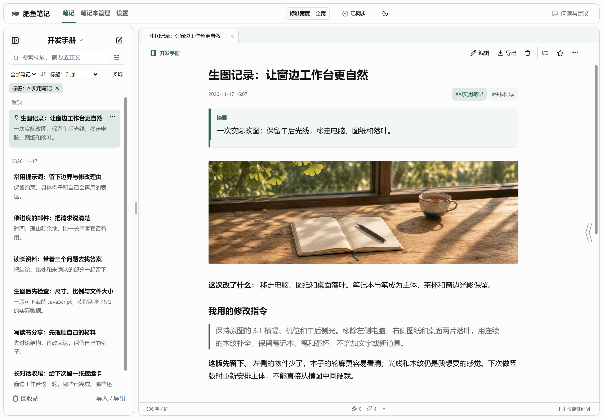
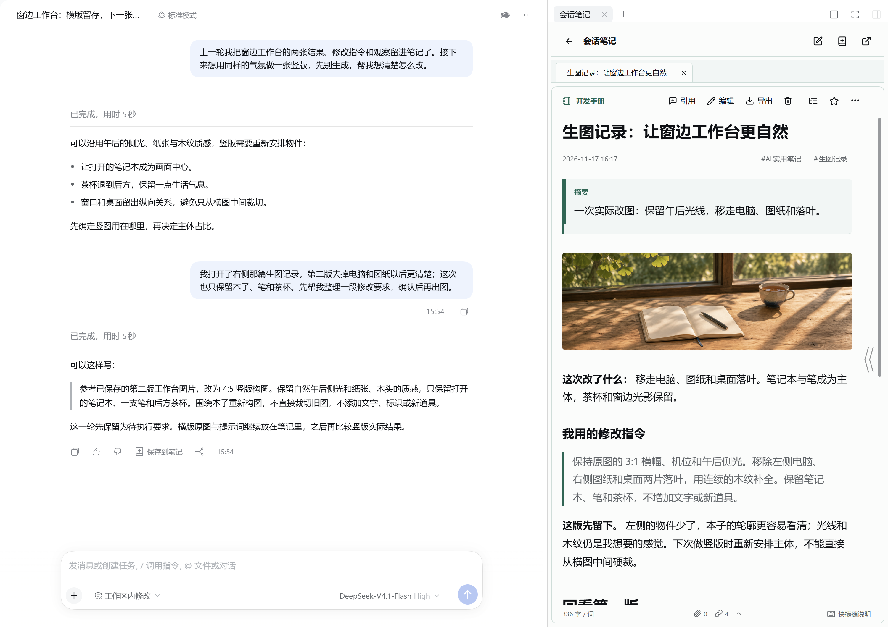
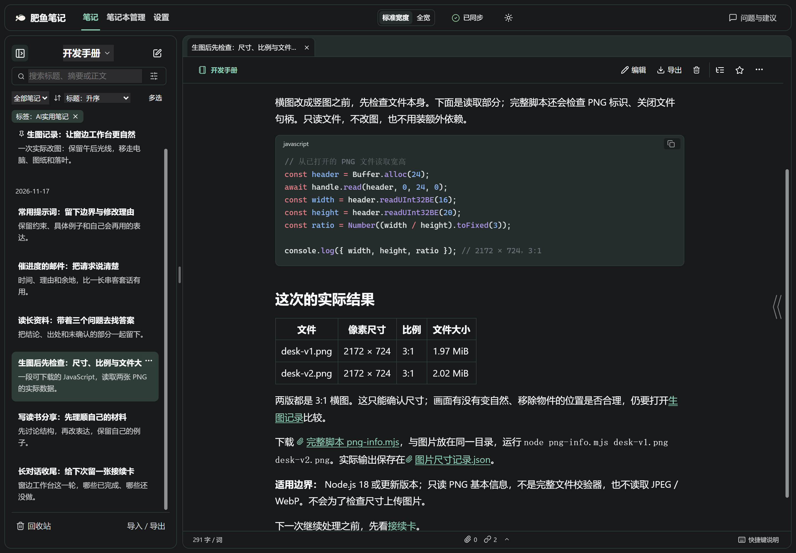
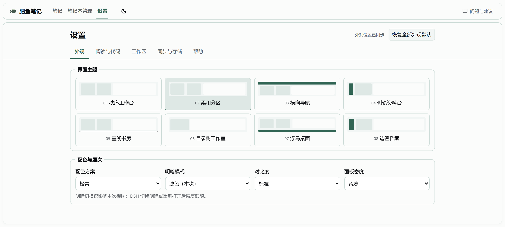

<p align="center">
  <picture>
    <source media="(prefers-color-scheme: dark)" srcset="assets/brand/showcase-20261117/fatfish-brand-transparent-dark.svg">
    
  </picture>
</p>

# Fatfish Notes · 肥鱼笔记

[简体中文](README.md)

Keep useful conversations as Markdown notes. Read, edit and reference them beside your chats, with local storage and sync through your own private GitHub repository.

> Version **0.9.3** declares DSH `>=0.2.2-rc.3 <0.2.3-0`. Verified on **rc.5 Windows Desktop, rc.4 Web and rc.5 Web mode**. See the [release notes](docs/releases/0.9.3/release-notes.md) and [verification record](docs/releases/0.9.3/review.zh.md).



## From conversations to notes

- Save a turn, selected messages or an entire conversation. Choose uploaded and AI-delivered files, preserve their position in the note, and keep the original conversation for comparison.
- Search, read, edit and create notes in the conversation sidebar. Link notes to a conversation and add a note-copy reading instruction to the composer for review before sending.
- Edit Markdown in place, paste or drop files, and switch images between inline display and download links.
- Search text and attachment names, combine filters, and jump to a matching passage. Organize with favorites, pins, note links, bulk actions and version history.
- Choose from eight layouts and ten palettes, adjust prose fonts and code highlighting, and share appearance preferences across views of the same DSH instance.
- Export a single PNG using the reading layout, a PDF for reading or printing, or a Markdown bundle with original images and files.
- Save locally while offline after initial setup; sync resumes when connected. Import Markdown files, folders or ZIPs, and export a notebook or the full library.



Keep code snippets, results, files and related notes together for the next time you need them.



## Installation and upgrade

Download the [latest stable plugin package, `dsh-fatfish-notes.tgz`](https://github.com/StarWind97/dsh-fatfish-notes/releases/latest/download/dsh-fatfish-notes.tgz). Versioned downloads and checksums are on the [0.9.3 release page](https://github.com/StarWind97/dsh-fatfish-notes/releases/tag/v0.9.3). Users staying on rc.1 can keep 0.8.0 and its corresponding data format.

Start DSH once to initialize its profile, then quit it. Install a matching package using its actual path:

```powershell
dsh plugin --profile desktop add "D:\Downloads\dsh-fatfish-notes.tgz"
```

Web users should replace `desktop` with their profile name. If `dsh` is not on PATH, use `resources\runtime\cli\bin\dsh.cmd` inside the DSH installation directory. Restart DSH and open Fatfish Notes.

Users on 0.9.1 or 0.9.2 can install 0.9.3 into the same DSH profile and reopen DSH with their existing notes and private repository. Finish syncing, close DSH and the separate note window, and back up the local notebook folder and `DSH_HOME/fatfish-notes`. **When upgrading from 0.8.0, upgrade all instances sharing one repository together.** A downgrade needs a matching host and pre-upgrade backup. Existing templates and edited handbooks remain available as notes.

## Getting started

1. Let setup check **Git** and **GitHub CLI**. Install missing tools using the official links, then recheck or restart DSH. The plugin runs these tools for you.
2. Sign in to your own **GitHub account**. Create a dedicated private library, or connect one previously created by this plugin on another computer.
3. Verify the repository and local folder, then complete the first sync. A new empty library includes a three-note handbook. Existing libraries can add it from **Settings → Help**.

Notes and archived resources live on your computer and in your private repository, not on the plugin author's servers. Initial setup requires a connection; local save and cloud sync are tracked separately afterward.

Editing saves automatically. Work in the main page, sidebar or a separate window, with editing handoff when two views open the same note. Open-note tabs last for the current window only.

Use list import/export for Markdown migration. Open exported copies in other editors instead of sharing the internal data directory. **Settings → Sync and storage** shows sync status, authorization and local storage options. Detailed [instructions](docs/user-guide.zh.md) are available in Chinese.



## Scope and limitations

- See the [0.9.3 verification record](docs/releases/0.9.3/review.zh.md) for the tested desktop and Web setups.
- The separate window uses installed Chrome or Edge and depends on DSH staying open.
- Appearance preferences are shared within one DSH instance, not across devices. Temporary light/dark overrides affect the current view; the sidebar always follows DSH. Favorites, pins and notebook order sync through the private repository.
- Referencing does not send a message automatically or register a native composer attachment. Optional AI suggestions cover title, summary and tags during capture; note bodies are edited manually.
- Ordinary attachments have no inline preview or playback. Files over 50 MiB require confirmation; the limit is 100 MiB. PNG/PDF exports do not bundle originals; use Markdown bundles for those.
- Import/export covers ordinary Markdown and common image, file and note links, not other apps' plugins, canvases or databases. Permanent deletion does not rewrite Git history or guarantee secure erasure.

Report problems through [Issues](https://github.com/StarWind97/dsh-fatfish-notes/issues), including OS, host/plugin versions and reproduction steps. Do not include credentials or private notes.

Code is [MIT licensed](LICENSE). See [third-party and font notices](THIRD_PARTY_NOTICES.md). Screenshots show the actual isolated interface with sample notes and a staged conversation; the screenshots retain the accepted scenarios, while the current brand icons are visible in the plugin. Development starts [here](docs/README.md).
