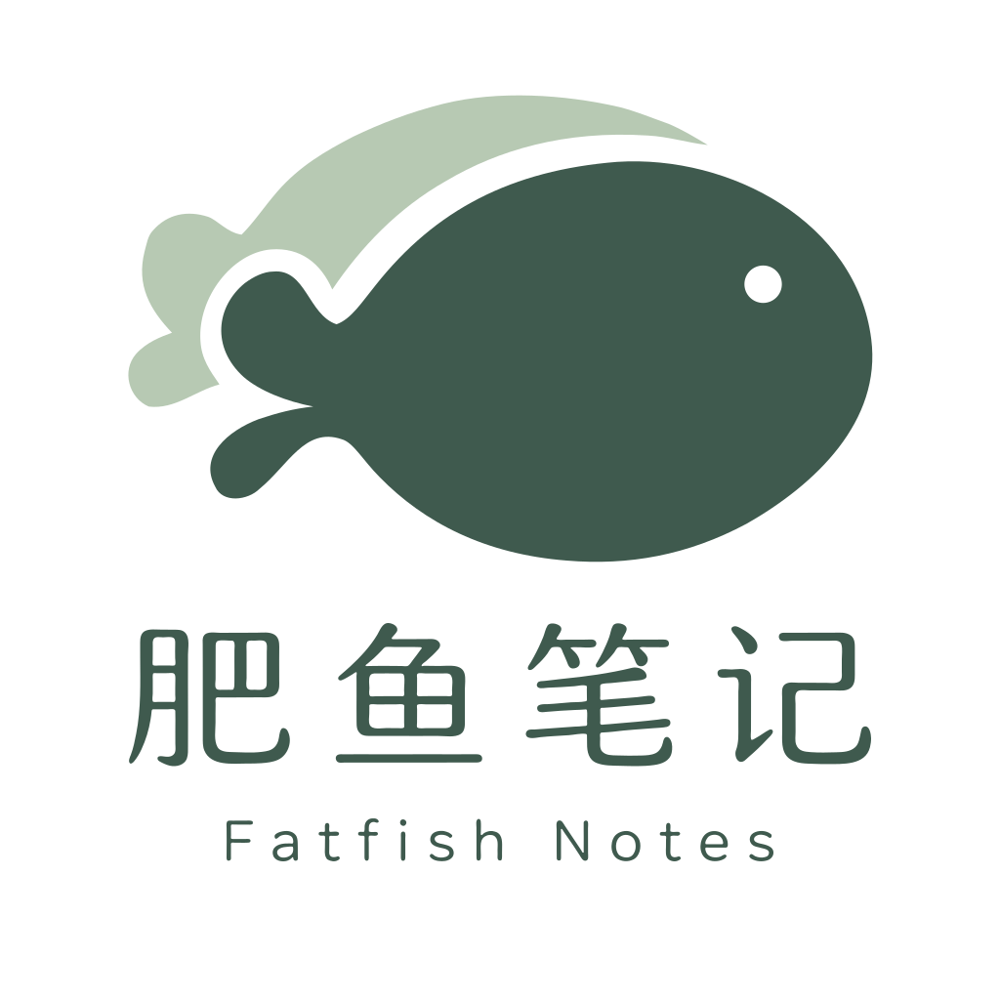
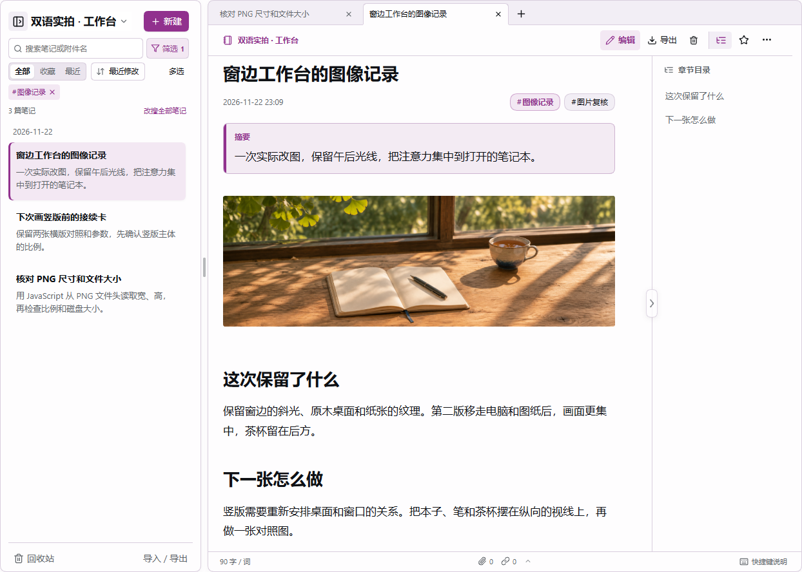
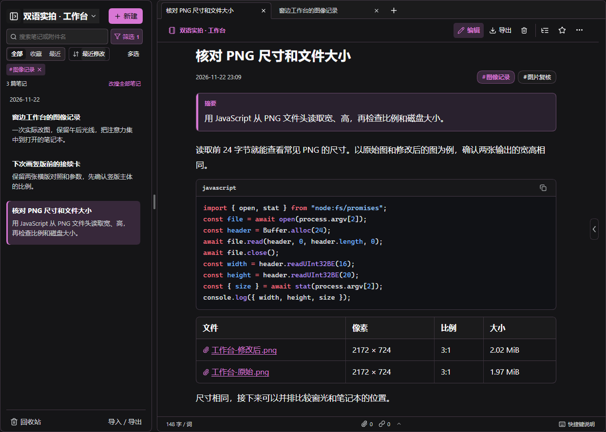
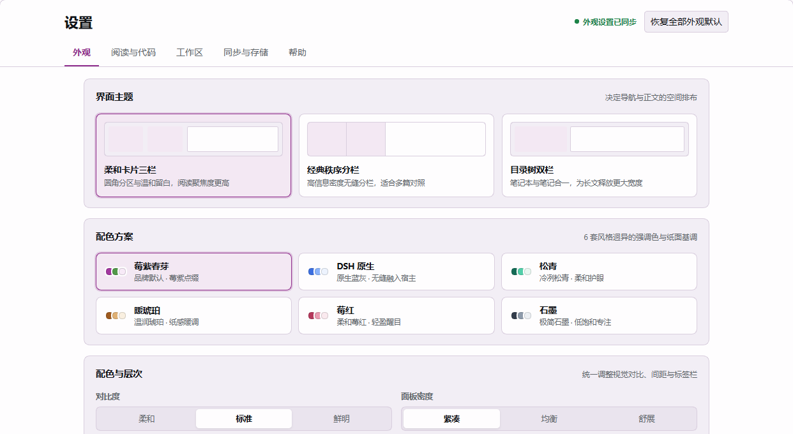

<p align="center">
  <picture>
    <source media="(prefers-color-scheme: dark)" srcset="assets/brand/fatfish-brand-transparent-dark.svg">
    
  </picture>
</p>

# 肥鱼笔记 · Fatfish Notes

[English](README.en.md)

把值得留下的会话整理成自己的笔记，在会话旁阅读、修改和复用。笔记保存在本机，通过自己的 GitHub 私有仓库同步。

> 肥鱼笔记 **0.13.0** 声明支持 DSH `>=0.2.2-rc.3 <0.2.3-0`。见[版本说明](docs/releases/0.13.0/release-notes.md)和[验证记录](docs/releases/0.13.0/review.zh.md)。



## 从会话到笔记

- **选择并保存**　保存一轮问答、几条消息或整个会话。宽窗自适应高度并排核对消息、图片缩略图与文件及笔记信息。会话标题会预填，AI 可根据所选消息的文字建议标题、摘要和标签。[转存图解](docs/user-guide.zh.md#保存会话里的问答)
- **在会话旁使用**　侧栏列表与阅读共享统一顶栏实现零跳动切换。从「关联的笔记」打开已关联资料，或用「查找笔记」搜全库；通过「笔记列表」回到上次查找。侧栏可以新建、阅读、编辑、关联笔记，也可以把笔记副本的读取说明加入输入框，检查后再发送。
- **自由整理内容**：原地编辑 Markdown，标题下方通过「编辑属性」抽屉按需修改笔记本、标签与摘要，粘贴或拖入图片和附件。纯图片默认展示，混合文件默认链接，图片可随时切换展示形式。
- **统一查找与快捷切换**　主界面、独立窗口和会话侧栏使用同样的搜索与筛选，列表支持「全部 / 收藏 / 最近」分段切换。主界面和独立窗口按 `Alt+K`（macOS `⌥K`）打开全局快速切换与命令面板，一步搜标题、正文、附件名、笔记本、标签与常用操作。
- **全库整理**　在「分类管理」改名、合并或移除标签前，可预览受影响的笔记、正文和标签变化。笔记支持收藏、置顶、互链、批量整理和历史恢复。[标签整理图解](docs/user-guide.zh.md#整理笔记本与标签)
- **按习惯阅读**　同时打开多篇笔记，拖动阅读标签调整顺序，点「+」打开概览查看最近打开或修改的笔记。主界面和独立窗口共享三套布局（柔和卡片三栏、经典秩序分栏、目录树双栏）、六种配色（含莓紫春芽）、中性炭黑深色层级、字体和代码高亮偏好，正文无标题时自动收起空目录列，侧栏明暗跟随 DSH。
- **按用途交付**：单张 PNG 沿用阅读版式与选定宽度（超宽表格会提示加宽以防裁列）；PDF 适合阅读和打印；Markdown 资源包保留图片及附件原件。
- **本机保存与私库同步**：通过三步向导完成首次接入后，断网仍可编辑保存，联网自动续传。可导入 Markdown 文件、文件夹或 ZIP，也可导出整本或整个笔记库。


代码片段、圆角结果表格、文件与关联笔记也可以一起保存，便于下次查找和复用。



## 安装与升级

下载[最新正式安装包 `dsh-fatfish-notes.tgz`](https://github.com/StarWind97/dsh-fatfish-notes/releases/latest/download/dsh-fatfish-notes.tgz)。指定版本与校验文件见 [0.13.0 发布页](https://github.com/StarWind97/dsh-fatfish-notes/releases/tag/v0.13.0)；如需回退上一公开版，见 [0.12.0 发布页](https://github.com/StarWind97/dsh-fatfish-notes/releases/tag/v0.12.0)。新版资料需由相应版本的插件读写。

取得与宿主匹配的插件包后，先打开一次 DSH 完成初始化，再完全退出 DSH。在终端执行，替换为实际文件路径：

```powershell
dsh plugin --profile desktop add "D:\Downloads\dsh-fatfish-notes.tgz"
```

重新打开 DSH，在左侧进入「肥鱼笔记」。Web 使用者将 `desktop` 换成自己的 profile 名称。若找不到 `dsh`，使用 DSH 安装目录下 `resources\runtime\cli\bin\dsh.cmd` 的完整路径。

0.10.0–0.12.0 用户可以在现有 DSH 资料中直接安装 0.13.0，重启后沿用原私库、笔记与已有手册修订，旧版已退役的布局和配色（含待同步队列）会自动平滑迁移。升级前完成同步，关闭独立窗口及 DSH，备份本机笔记资料夹和 `DSH_HOME/fatfish-notes`。**从 0.8.0 升级时，同一私库各端须一起升级宿主与插件。** v3/v4 资料需要新版插件，回退需要配套宿主及升级前备份。旧模板和已编辑的手册继续作为笔记保留。

## 开始使用

1. **准备工具**：首次设置通过三步向导检查 Git 和 GitHub CLI；缺少时提供官方安装入口。安装后重新检测，必要时重启 DSH。插件自动使用这些工具，无需学习 Git 命令。
2. **连接私有笔记库**：登录自己的 GitHub 账号，新用户可创建专用私库；换电脑则连接由本插件创建的已有私库。
3. **确认位置并同步**：核对账号、云端仓库和本机资料夹，完成首次同步。新建的空库会按 DSH 的语言提供三篇用户手册。已有库可以从「设置 → 帮助」打开或添加当前语种的手册。

笔记、归档图片和附件位于你的电脑及自己的私有仓库，不存放在插件作者的服务器。首次同步需要联网；之后本机保存与云端同步分别显示状态。

编辑时自动保存。可在 DSH 主页面、会话侧栏或独立窗口继续工作；同一篇笔记在两处编辑时提供交接。收藏与置顶是不同操作。打开的笔记标签在当前窗口内保留。

从笔记列表「导入 / 导出」迁入或导出 Markdown。将导出的副本用于 Obsidian 等软件，不要让其他软件直接写入内部资料目录。「设置 → 同步与存储」可以查看状态、恢复账号授权和更换本机位置。详见[使用说明](docs/user-guide.zh.md)。



## 使用边界

- 桌面和 Web 的实测范围见 [0.13.0 验证记录](docs/releases/0.13.0/review.zh.md)。
- 独立窗口使用 Windows 上已安装的 Chrome 或 Edge，依赖 DSH 保持运行。
- 外观偏好在同一 DSH 内共享。笔记主界面顶栏切换并保存 DSH 明暗，独立窗口的明暗切换只影响本次视图。收藏、置顶和笔记本顺序随私库同步。
- 引用不会自动发送，也尚未登记到宿主原生附件栏。AI 只在转存时可选生成标题、摘要和标签，正文由用户编辑。
- 普通附件不提供内嵌预览或播放；超过 50 MiB 提醒确认，上限 100 MiB。PNG/PDF 不附带原文件，要交付原件请用 Markdown 资源包。
- 导入导出覆盖普通 Markdown 与常见图片、文件、笔记链接，不迁移其他软件的插件、白板或数据库。彻底删除不重写 Git 历史，不等同于安全擦除。

问题与建议可从「设置 → 帮助 → 问题与建议」或直接通过 [Issues](https://github.com/StarWind97/dsh-fatfish-notes/issues) 提交，请附系统、DSH/插件版本及复现步骤，不要提供凭据或私人笔记。

开发见[开发入口](docs/README.md)、[项目约定](AGENTS.md)与[产品设计](docs/notes-design.zh.md)。代码采用 [MIT](LICENSE)，字体及第三方依赖见[授权说明](THIRD_PARTY_NOTICES.md)。截图来自实际界面，使用演示笔记与编排会话。[取景记录](assets/screenshots/0.13.0/README.md)
