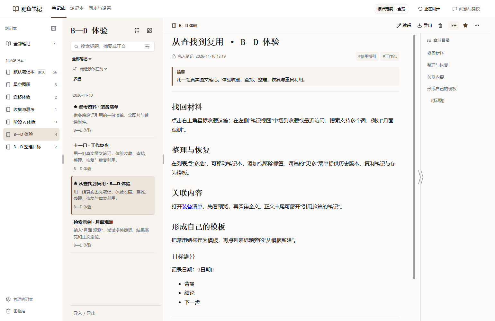

# 肥鱼笔记 · Fatfish Notes

[English](README.en.md)

保存会话、管理图文笔记、导出文件，通过自己的 GitHub 私有仓库跨设备同步。

**0.8.0** 新增独立窗口、自适应三栏、收藏与查找、历史恢复、批量整理、反向链接和模板，并改善读取与切换速度。见[更新说明](docs/releases/0.8.0/release-notes.md)与[验证记录](docs/releases/0.8.0/review.zh.md)。

在 DeepSeek Harness 中把一轮问答、选中的几轮消息或整个会话保存为私人笔记。在纸页笔记库阅读、编辑 Markdown、粘贴图片和导出文件。首次使用需连接一个专用 GitHub 私有仓库。完成首次同步后可在本机保存，并在自己的设备之间继续工作。



- **原样保存会话**：在回答下方保存当前问答，也可选择多轮、单条消息或整个会话，保留只读原始素材。
- **Markdown 图文编辑**：原地编辑、语法与预览切换，支持标题、列表、代码块、表格和图片，跟随宿主深浅色。
- **与会话并行使用**：在 DSH 内或独立窗口打开笔记，宽窗展开三栏；同一篇笔记可在两处交接编辑。
- **查找、整理与复用**：收藏、最近访问、多关键词搜索与正文定位；历史预览与恢复、批量移动和修改标签、反向链接及独立模板。
- **文件导出**：笔记支持 Markdown 资源包、图片和 PDF；当前开发候选将会话导出统一到保存后的笔记页。
- **笔记本与迁入迁出**：未指定位置的笔记进入默认本；导入 Markdown 文件、文件夹或 ZIP，整库或单本导出后可供 Obsidian 等软件阅读。
- **附件与笔记互链**：保存和下载 PDF、音频、视频等普通附件，在文章之间插入链接并跳转。
- **批量清理**：多选移入回收站，支持单篇、多篇彻底删除及清空，保留仍被其他笔记使用的文件。
- **自己的私人笔记库**：本机保存，通过自己账号下的专用 GitHub 私有仓库跨设备同步。

当前 `main` 是 E 阶段开发版，尚未发布：增加会话侧栏、笔记关联、上传/交付文件选材、引用到会话，以及后台分块导入。已发布版本仍为 0.8.0；开发版规则与体验见 [E 阶段交付](docs/plans/2026-11-11-stage-e-results.zh.md)。

## 安装与升级

当前版本为 `0.8.0`，适用于 DSH `0.2.2-rc.1`。Windows 已验证，macOS 尚未实测。请准备自己的 GitHub 账号；首次设置会检测 Git 和 GitHub CLI，缺少时提供官方安装入口。

从 [0.8.0 发布页](https://github.com/StarWind97/dsh-fatfish-notes/releases/tag/v0.8.0)下载 `dsh-fatfish-notes-0.8.0.tgz`，不要下载自动生成的 Source code 压缩包。先打开一次 DSH 完成资料初始化，再完全退出。在终端执行以下命令，将路径替换成实际安装包位置：

```powershell
dsh plugin --profile desktop add "D:\Downloads\dsh-fatfish-notes-0.8.0.tgz"
```

重新打开 DSH，在侧栏进入「肥鱼笔记」。Web 使用者将命令中的 `desktop` 换成自己的 profile 名称。如果终端找不到 `dsh`，使用 DSH 安装目录下 `resources\runtime\cli\bin\dsh.cmd` 的完整路径。

升级使用同一安装命令，替换为实际安装包路径即可，不需要先卸载或重新绑定。仅完成初始化的空库，升级后会提供默认笔记本。

如已有内容，升级前确认「已同步」，关闭独立笔记窗口及 DSH，备份本机笔记资料夹和 `DSH_HOME/fatfish-notes`。同一私库的各端应一起升级；0.8.0 的收藏、模板等修订字段旧版不能识别，回退需要相配套的资料备份，不能只重装旧包。卸载、备份恢复和问题反馈见[使用说明](docs/user-guide.zh.md#安装升级与卸载)。0.5.x 旧名称的历史迁移另见[改名规划](docs/plans/2026-11-06-fatfish-notes-rename.zh.md)。

## 开始使用

笔记和图片保存在这台电脑，并同步到你自己的 GitHub 账号下的私有笔记库，默认不公开，也不存放在插件作者的服务器上。GitHub「仓库」就是云端保存笔记的空间。

首次打开时，按页面上的三步完成设置：

1. **准备同步工具**：Git 负责文件同步，GitHub CLI 负责账号授权。缺少时点击官网安装链接，安装后点「重新检测」；仍检测不到时完全退出并重新打开 DSH。安装完成后由插件自动使用，无需学习命令。
2. **登录并选择云端笔记库**：没有 GitHub 账号可先注册，再点击「登录 GitHub」完成浏览器授权。首次使用默认推荐「新建私人笔记库」，建议名称为 `fatfish-notes`；换电脑或恢复资料选择「连接已有笔记库」。
3. **确认保存位置并同步**：本机默认资料夹与云端笔记库同名，也可指定新的空资料夹。点「检查并继续」，核对账号、笔记库和本机位置，再确认首次同步。

「已安装」「已登录」只表示完成对应准备，首次同步成功后才能开始使用。完成设置后临时断网仍可在本机保存，联网后自动继续同步。详细操作见[首次设置说明](docs/user-guide.zh.md#首次设置)。

在任意回答下方点击「保存到笔记」，默认在当前会话勾选该轮，也可继续勾选其他轮次或整个会话。E 开发版统一点击「下一步」打开保存选项，确认消息、图片/附件、目标笔记本及可选 AI 建议后保存；Esc 或返回会话保留勾选。按钮默认显示图标和文字，外观设置可改为仅图标。AI 只在后台生成简短标题、摘要和标签，不再追加会话问答；原文先保存，可随时切回原始素材对照。

当前未发布候选移除回答下独立「导出」按钮；先将会话保存为笔记，再选择 Markdown 资源包、阅读图片或 PDF。图片默认按当前阅读宽度和主题生成，2× 不改变排版；PNG/PDF 不额外打包附件原件。具体范围见[统一体验规划](docs/plans/2026-11-13-experience-capture-export.zh.md)。

点击顶部「编辑」即可手动修改标题、标签、摘要和 Markdown 正文。从 `0.5.1` 起自动保存，「完成编辑」或离开后回来均从最新内容的阅读态继续，详见[使用说明](docs/user-guide.zh.md)。列表宽度可拖动，正文可切换标准宽度与全宽，配色跟随宿主。「导出」提供 Markdown、PDF 及单张 PNG 图片。带图片的 Markdown 推荐用 ZIP，解压后可离线阅读。导出时可分别选择包含标签、包含摘要。阅读双击用于选择文字，Home/End/Page Up/Page Down 用于滚动。点击笔记标签可以筛选列表，点击搜索框下的筛选标记即可清除。

## 导入、附件与整库导出

从笔记列表底部「导入 / 导出」选择 Markdown 文件、文件夹或 ZIP，先查看扫描结果，再决定保存到哪个笔记本。有图片和附件时，选择完整文件夹或 ZIP。导入创建新笔记，不覆盖来源；网络图片可选择下载归档，失败项会保留引用并提示。

整库或单本导出为 ZIP，解压后以笔记本为目录、标题为 Markdown 文件名，图片和附件采用相对路径。可将解压后的副本作为 Obsidian vault 打开。常见 Wiki 图片和笔记链接可导入转换，不迁移第三方插件、白板、数据库或全部专有属性；不要让其他笔记软件直接编辑肥鱼笔记内部资料目录。

编辑时可添加 PDF、音频、视频等普通附件，保存后下载或另存，不提供预览和播放。E 开发版超过 50 MiB 会提醒确认，单文件上限 100 MiB（公开 0.8.0 为 10/50 MiB），大文件会增加同步耗时。通过「链接 → 链接到笔记」可搜索并插入另一篇笔记，改名或换本不影响跳转。

## 私有备份

在「同步与设置」可以查看已绑定的账号、私有仓库、本机资料夹及实时同步状态。若提示未登录，可在「同步账号」点击「登录 GitHub」，按提示使用原绑定账号完成授权；不会更换笔记库或本机位置。「更换本机位置」可在断网时搬迁当前笔记和附件。从 A 切到 B，再通过「重置笔记库」接回已有的 A，插件会查找本机上次使用的 A 资料夹。核对通过后直接确认使用。找不到时可选择原资料夹现在的位置，或新建一个本机资料夹并从远程 A 同步。当前库和目标库都完成同步才切换。两台设备连接同一个私有仓库。打开笔记库会检查更新，断网时仍可编辑和保存，窗口显示「有更改尚未同步」，恢复网络后自动重试。并发编辑同一篇笔记会保留带冲突版本后缀的独立笔记，使用者可分别改名、编辑或删除。

## 开发

开发环境为 Windows / Node 24.21.0 / DSH 0.2.2-rc.1。实际覆盖范围见[验证记录](docs/verification-log.zh.md)。

开发按改动影响选择验证范围，具体步骤见[开发入口](docs/README.md)与[项目协作约定](AGENTS.md#验证范围)。产品行为见[设计](docs/notes-design.zh.md)，日常操作见[使用说明](docs/user-guide.zh.md)。

## 限制与反馈

独立窗口目前使用 Windows 上已安装的 Chrome 或 Edge，并依赖 DSH 保持运行。关闭 DSH 后暂停编辑，重新启动同一套资料后恢复连接。收藏和模板随私库同步；最近访问保存在当前浏览器，不跨窗口或设备同步。

E 开发版可从会话侧栏将笔记副本的读取说明加入输入框，保留原文且不自动发送；暂不支持直接登记到原生附件栏。AI 仅在转存会话时可选建议标题、摘要和标签，正文由用户手动整理。Obsidian 实际导出兼容验证为 1.10.6；macOS 和两台物理设备之间的使用尚待实测。彻底删除不重写 Git 历史，不等同于安全擦除，也不会立即缩减历史仓库体积。

问题与建议请提交 [Issue](https://github.com/StarWind97/dsh-fatfish-notes/issues)，附系统、DSH 与插件版本、操作步骤及遮去私人信息的截图，不要上传令牌或完整私人笔记库。

代码使用 [MIT 许可证](LICENSE)。第三方依赖与字体说明见 [THIRD_PARTY_NOTICES.md](THIRD_PARTY_NOTICES.md)。展示截图来自隔离实例，内容为示例。
