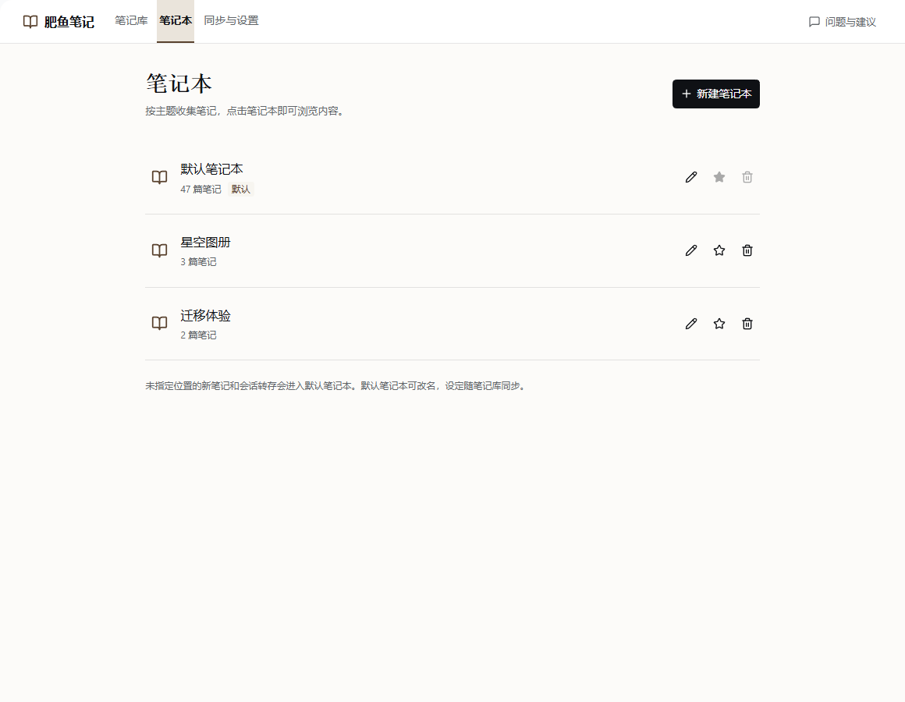
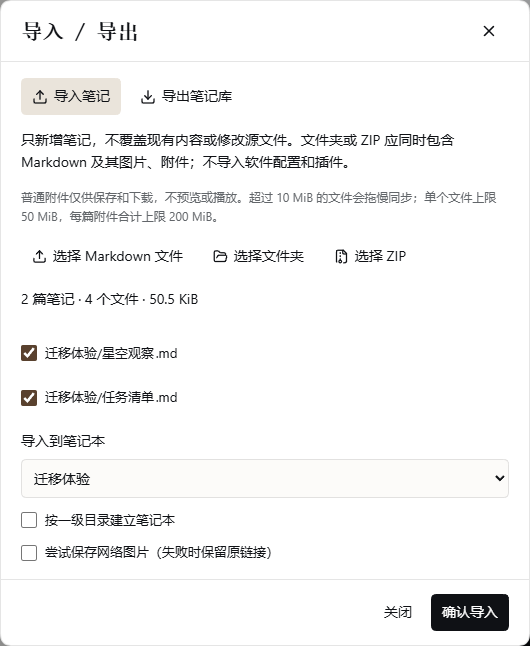

# 0.7.0 发布审核

状态：2026-11-09 用户审核通过并批准正式发布；正在更新正式安装包、发布资产及市场条目。完成后在下方记录公开核验与市场状态。

## 用户审核材料

- [发布说明](release-notes.md)：正式发布时使用的更新介绍与必要边界。
- [市场条目草稿](marketplace-entry.yml)与 [PR 正文草稿](marketplace-pr.md)：更新原条目，不重复收录。
- [使用说明](../../user-guide.zh.md)与[准备规划](../../plans/2026-11-09-release-070.zh.md)。

当前唯一使用者仅完成初始化，没有正式笔记或自建笔记本。本次验证空库升级，不要求用户处理历史内容；不修改日常 DSH。

## 正式包准备

用户确认后更新中英文 README 的正式版本及下载入口，新增截图加入市场截图清单。最终运行代码与已审核候选包一致，沿用 238 项回归和实际功能验证。

- 正式包：`dist/dsh-fatfish-notes-0.7.0.tgz`，139 文件，14,313,751 字节。
- SHA-256：`9f35c69d5ee1789a14f49269e12cc6d194e76665102887de821d5141dba816c7`。
- 正式说明包已再次安装到隔离 Desktop，139 个文件逐项匹配。公开下载与公开包安装结果在发布后补记。

## 已审核候选包与验证（历史）

- 已审核候选包：139 个文件，14,313,859 字节；保留于 `.dsh-home/pure-001/release070-reviewed-candidate.tgz`。
- 历史候选 SHA-256：`896509c340e8a5094f1c1c1d58bda04c955eaf976249e51805471d820dfcd8f7`。正式包采用上方新摘要，当前校验文件为 `dist/SHA256SUMS-0.7.0.txt`。
- 与上一份已验证 0.6.1 开发包逐文件比较，仅 `package.json` 和中英文 README 改变，运行代码一致；YAML 许可证包含在包中，没有测试资料、缓存或凭据。
- 类型检查、构建及本次发布级 **238/238 全量回归通过**，0 失败、0 跳过，约 12 分 47 秒。按第三档执行，因为本次交付为对外发布候选包。
- **空库升级**：从实际 0.6.0 发布包的存储实现生成空库及 v1 清单，交给 0.7.0 后出现且只出现一个默认本。重开仍无笔记，第一篇新建笔记自动归入默认本。这是隔离离线数据升级验证，没有接管用户日常库。
- **实际安装**：候选包安装到隔离 Desktop，139 个安装文件逐项匹配。原指定私库绑定保留，新建示例笔记通过实际编辑器保存，GitHub 双向同步返回 idle / pending=false；重启后正文和归属保留。GitHub API 另行确认新笔记文档及修订已在远端，证据为 `release070-remote.json`。
- **实际操作**：现有图片正常显示，文章链接跳转/返回正常；最终包的导入预览和导出入口已验。实际导出的 ZIP 含两篇 Markdown、一张图片及两个普通附件。页面未记录异常。
- 最初验收脚本将「导出笔记库」按钮误写为「导出」，已修正脚本并只补验未完成步骤，没有修改产品代码。
- Obsidian 1.10.6 的真实兼容验收沿用相同运行代码的[上一批结果](../../verification-log.zh.md#obsidian-补验2026-11-09)。macOS、两台物理电脑及 Obsidian 1.15.0 不宣称已覆盖。

记录为 `.dsh-home/pure-001/release070-{checks,tests}.log`、`release070-{audit,installed,empty-upgrade,ui}.json`。验收截图在 `output/playwright/release070/`。本批测试结束已关闭自建 DSH；通过 [Open-Fatfish-Notes.cmd](../../../scripts/Open-Fatfish-Notes.cmd) 可重新打开 0.7.0 隔离体验，不涉及日常资料。

### 实际界面

### 当前用户怎样升级

用户已确认只有本人使用，且当前库仅初始化，没有创建笔记或笔记本。正式发布后关闭 DSH、安装 0.7.0、重新打开，核对原绑定和默认笔记本即可；不必先卸载、不必重新初始化，也不需要搬迁内容。此次准备未替用户安装到日常资料。

## 发布边界

本阶段只准备并提交源码及材料。未创建 v0.7.0 标签、GitHub Release、市场 PR 或 npm 发布。用户审核通过后，才正式发布并验证公开下载，再提交市场更新。市场提交、维护者合并与页面实际可见分别记录。

正式发布时将 README 中的候选状态及下载入口改为正式版，重新打包记录最终摘要并核验公开包安装。若差异仅为说明文件，可沿用本次运行代码验证；若修改运行代码，则按影响范围补验。不得把当前候选包摘要直接当成重新打包后的公开资产摘要。
