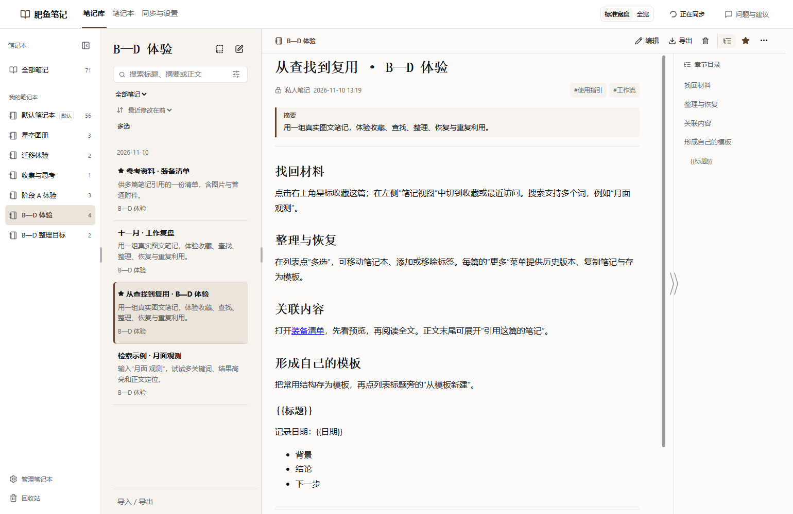
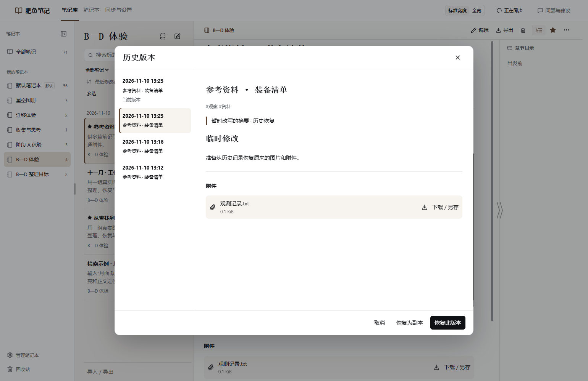

# 0.8.0 发布审核

状态：2026-11-10，用户认可 A—D 与性能优化体验后，发布前准备已完成。候选包、升级验证、实际安装和同步检查已完成，等待正式发布确认；尚未发布、上传资产或提交市场更新。

## 审核材料

- [发布说明](release-notes.md)
- [市场条目草稿](marketplace-entry.yml)与 [PR 正文草稿](marketplace-pr.md)
- [准备规划](../../plans/2026-11-10-release-080.zh.md)、[性能实测](../../plans/2026-11-10-performance-results.zh.md)与[功能验收](../../plans/2026-11-10-bcd-results.zh.md)

公开版本仍为 0.7.0，其市场更新 [PR #13502](https://github.com/awesome-dsh-plugin/awesome-dsh-plugin/pull/13502)已于 2026-11-10 08:14（北京时间）合并。本次更新原条目，不重复申请收录。

## 最终检查

- 候选包：`dist/dsh-fatfish-notes-0.8.0.tgz`，151 个文件，15,033,279 字节。
- SHA-256：`43bdf1002d304d3d588ba64c3f07a9f741bbbd98d0633509ec353ec3a360f3b4`，校验文件为 `dist/SHA256SUMS-0.8.0.txt`。保留按摘要命名的副本 `dist/fatfish-080-candidate-43bdf1002d30.tgz`。
- 与用户已体验的性能优化包逐文件比较，仅 `package.json` 和中英文 README 改变；运行代码、依赖和其他打包文件相同。无测试 profile、源码、缓存或凭据，字体与必要许可证均随包分发。
- 已实际安装到 `release12-desktop` 隔离资料，版本为 0.8.0，151 个文件与包逐项一致。
- 按发布第三档依次完成类型检查、构建和全量回归。全量 261 项首次 260 项通过、1 项失败，无跳过，约 13 分 39 秒。失败发生在「切换到已有 B 仓库」测试创建 Git 缓存时，Windows 目录重命名返回 `EPERM`，不是断言差异；具体占用来源未确认。保持代码、断言与测试目录配置不变，该项单独连续复测两次均通过。没有把首次失败改写成一次全绿，也没有放宽校验或修改产品代码。
- 全量日志 `release080/tests.log`、复测日志 `retest-1.log` 和 `retest-2.log`，均位于 `.dsh-home/pure-001/`；运行代码与此前 A—D 和性能专项相同。

## 升级验证

以已匿名下载的公开 0.7.0 安装包为旧实现，先核对其原发布 SHA-256，再创建隔离的空库和有内容的笔记库。0.8.0 读取后，空库保留同一个默认笔记本；已有正文、标签、摘要、笔记本归属、旧修订及图片/普通附件字节保持不变。随后可收藏并保存独立模板，重开仍保留，原文的三次历史修订可读。

这是真实旧版存储实现到候选实现的离线资料升级，实际宿主安装和私库绑定另行验收；没有接管用户日常资料。脚本及结果为 `.dsh-home/pure-001/release080/upgrade.mjs`、`upgrade.json`。

## 备份与回退

安装前已保留隔离笔记、profile 安装配置和上一性能包，备份在 `.dsh-home/pure-001/release080/install-backup-20261110-151645/`。候选版可回到同样支持 A—D 字段的性能包。若需退回公开 0.7.0，须关闭相关窗口并恢复与该版本配套的本地和云端资料备份；不能仅替换程序继续写新版资料。没有重写远端历史。

实际安装与包核对结果为 `.dsh-home/pure-001/release080/installed.json`、`audit.json`。

## 最终宿主与性能抽查

在安装的 0.8.0 候选包上，通过隔离 DSH 侧栏进入笔记，并打开共用同一服务的独立 Chrome 页面。实际读取已有归档图片和普通附件字节、预览历史、编辑并完成保存；另一窗口自动显示最新正文，同篇编辑保护仍生效。指定私库 `StarWind97/dsh-community-private-test`（仓库 ID `1440762952`）同步成功，状态 `idle/pending=false`。关闭后重启精确读回新正文；本轮临时验收笔记通过正常回收站/彻底删除接口清理并再次同步。

最终包的性能抽查沿用 B—D 隔离示例和前次点击到内容绘制完成的口径，在全量回归和复测结束后单独进行：

| 操作 | 样本数 | 中位数 / 最大值 |
| --- | --- | --- |
| DSH 内切换笔记本 | 10 | 104 / 146 ms |
| DSH 内打开普通正文 | 5 | 117 / 134 ms |
| DSH 内打开 1108 字符示例 | 5 | 113 / 128 ms |
| 独立窗口切换笔记本 | 10 | 158 / 183 ms |
| 独立窗口打开普通正文 | 5 | 150 / 167 ms |
| 独立窗口打开 1108 字符示例 | 5 | 164 / 183 ms |

独立页面首次加载单次为 1.269 秒；DSH 侧栏就绪后点击笔记至正文显示单次为 1.736 秒。两项首次加载均不作为稳定性承诺。自动脚本中包含 DSH 侧栏启动等待的 5.943 秒不作为插件首次加载时长。原前后对比及约 4000 字符文章补验沿用相同运行代码的[性能交付](../../plans/2026-11-10-performance-results.zh.md)，不重复测旧版基线，也不推断数千篇资料库速度。

原始记录为 `.dsh-home/pure-001/release080/verification.json`、`candidate.json`、`metrics-summary.json`。测试结束已关闭自建 DSH 和 Chrome，仍可通过 [Open-Fatfish-Notes.cmd](../../../scripts/Open-Fatfish-Notes.cmd)重新体验候选版。没有操作日常 DSH 或调用模型额度。macOS、两台物理设备、硬断电与大型真实资料库仍未覆盖。

## 实际效果

截图来自本次最终候选包的隔离示例；拍摄时同步尚在进行，随后已完成上述实际同步核验。

## 发布确认后

更新中英文 README 的公开下载入口，核对最终包与已审核包的运行代码一致，再创建 `v0.8.0` 标签和 GitHub Release、上传安装包及 SHA-256 文件；匿名下载和公开 URL 安装通过后提交市场更新。说明文件变化不重跑未受影响的全量测试，最终包采用最终摘要。

不发布 npm。市场提交、维护者合并和市场页面可见分别核对，不将提交成功当作已经上架。
