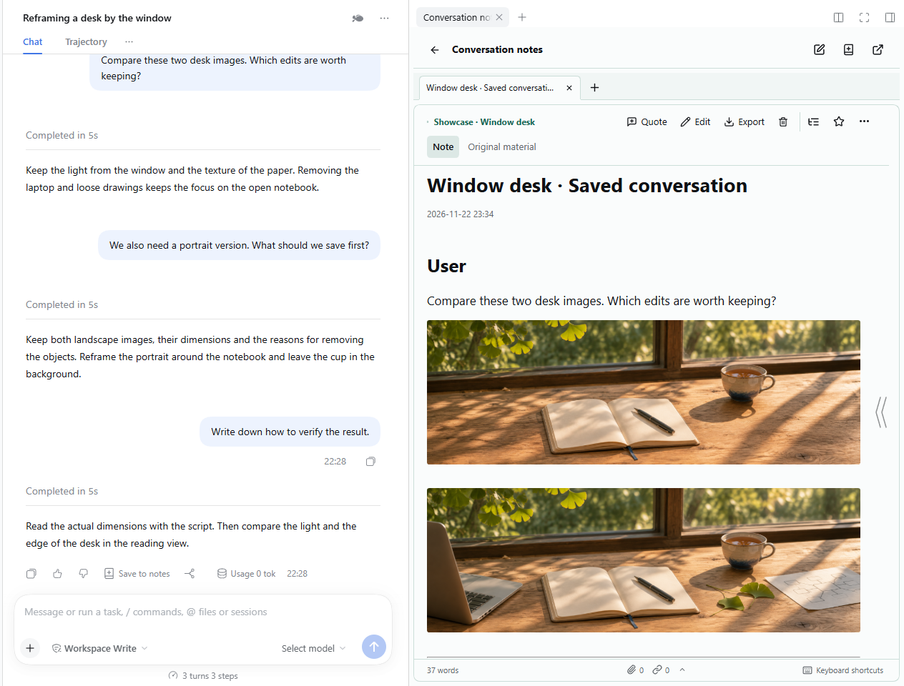
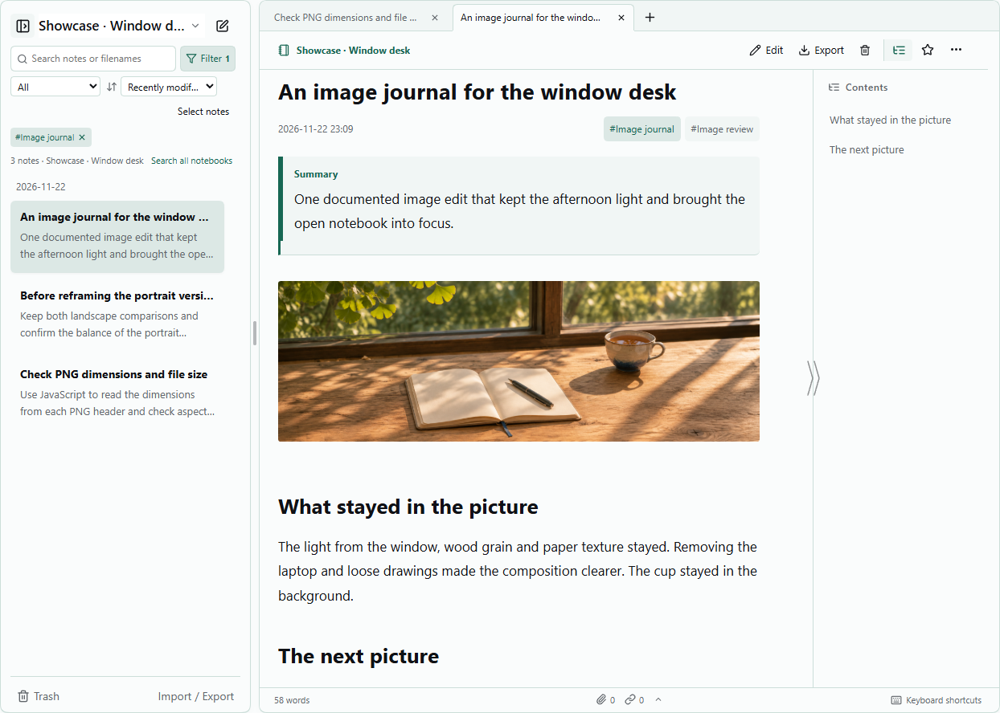
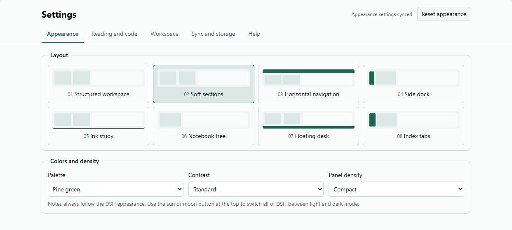

# Fatfish Notes illustrated guide

[简体中文](user-guide.zh.md)

Fatfish Notes follows the language selected in DSH. Use **Settings → General → Language** in DSH to switch between English and Simplified Chinese. Your own notes and saved conversation text keep their original language.

[Save a conversation](#save-a-conversation) · [Use notes beside a conversation](#use-notes-beside-a-conversation) · [Write and find notes](#write-and-find-notes) · [Organize your library](#organize-your-library) · [Set up your library](#set-up-your-library) · [Save and sync](#save-and-sync) · [Export and move notes](#export-and-move-notes)

## Save a conversation

Click **Save to notes** below a completed AI reply. The current exchange starts selected. Select other turns or the whole conversation, and click **Next**.

In **Save options**, review the messages and materials, choose a notebook, and check the prefilled title. In a narrow window, select **Expand layout** to see every section, or review the selection and files individually. Switching layouts keeps your selections and edits.

Use **AI suggestions** if you want a suggested title, summary and tags. It uses the text of the selected messages. Edit the suggestions if needed, then save. **Original material** in the note shows the preserved source.

## Use notes beside a conversation

Click the fish icon in the conversation header to open **Conversation notes**. Open **Linked notes** to find notes saved from that conversation. Use the search view to find other notes in your library. When a note is open, use the back arrow or the **Note list** tab to return to the list.

To give the current conversation the contents of a note, open it in the sidebar and choose **Quote**. Review the materials, then select **Add to message**. Review the reading instructions in the message, add your request and send it.

## Write and find notes

Click **New note**, or open a note and click **Edit**. Write or paste Markdown directly in the body, and use the toolbar for common formatting. Use **Done** to finish editing.

Search your whole library or a single notebook. Enter remembered words or an attachment name, then narrow the results by tag, date or attachments. Select a matching text passage to jump to it. Reading tabs let you move between several notes and **+** opens the overview.

## Organize your library

Choose **Organize** and open **Notebooks** or **Tags**. To merge tags, select the source tag and choose **Merge**. Look up the tag you want to keep, inspect the affected notes and confirm if the changes are correct. A preview is also available before renaming or removing a tag.

## Set up your library

Install the package in your DSH profile, restart DSH, then open **Fatfish Notes**. First setup requires an internet connection. The guide checks for **Git** and **GitHub CLI** and helps you sign in to GitHub.

1. Create a dedicated private notebook repository for a new library, or connect to an existing library created by Fatfish Notes.
2. Review the account, repository and local folder. Confirm the first sync and wait for it to finish.
3. A newly initialized empty library has a handbook in the selected interface language. In an existing library, use **Settings → Help** to open or add that language's handbook.

See the [installation instructions](../README.en.md#installation-and-upgrade) and [setup reference](user-guide-reference.en.md#first-setup).

Use **Settings → Appearance** to choose a layout and palette for the main view and separate window.

## Save and sync

| Status | Meaning |
| --- | --- |
| Draft saved locally | A draft is available on this device while you edit. |
| Saved | The note is stored on this device. |
| Synced | Saved changes have been backed up to the private repository. |

After first setup you can read, edit and save while offline. Before leaving one device to continue on another, check for **Synced** or use **Settings → Sync and storage → Sync now**.

## Export and move notes

Click **Export** in a note. Choose Markdown for editable text, PDF for paginated reading and printing, or PNG for a single image of the reading layout. Choose a Markdown bundle to include the original images and attachments. To import Markdown or export a notebook or library, use **Import / Export** in the note list.

For other operations including separate windows, keyboard navigation, data recovery and file handling, see the [detailed reference](user-guide-reference.en.md).

Applies to **0.11.1**. [Release notes](releases/0.11.1/release-notes.md).
