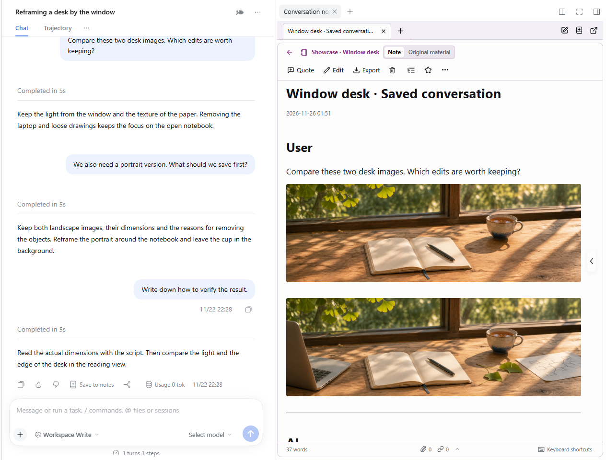
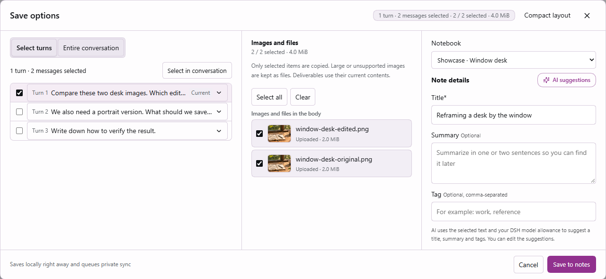
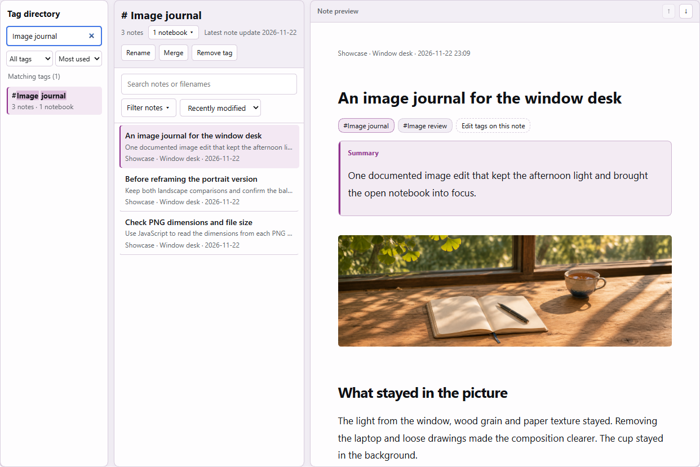

# Fatfish Notes illustrated guide

[简体中文](user-guide.zh.md) · Applies to **0.13.0** ([Release notes](releases/0.13.0/release-notes.md))

Fatfish Notes follows the language selected in DSH. Use **Settings → General → Language** in DSH to switch between English and Simplified Chinese. Your own notes and saved conversation text keep their original language.

[Save a conversation](#save-a-conversation) · [Use notes beside a conversation](#use-notes-beside-a-conversation) · [Write and find notes](#write-and-find-notes) · [Organize your library](#organize-your-library) · [Set up your library](#set-up-your-library) · [Save and sync](#save-and-sync) · [Export and move notes](#export-and-move-notes)

## Save a conversation

Click **Save to notes** below a completed AI reply. The current exchange starts selected. Select other turns or the whole conversation, and click **Next**.

In **Save options**, review the messages and live image thumbnails, choose a notebook, and check the prefilled title. Wide windows adapt to content height; in a narrow window, select **Expand layout** to see every section, or review the selection and files individually. Switching layouts keeps your selections and edits.

Use **AI suggestions** if you want a suggested title, summary and tags. It uses the text of the selected messages. Edit the suggestions if needed, then click **Save to notes** (or **Cancel** at the bottom to exit capture). **Original material** in the note shows the preserved source.

## Use notes beside a conversation

Click the fish icon in the conversation header to open **Conversation notes**. The note list and reading view share a unified top bar so switching stays steady without vertical jump. Open **Linked notes** to find notes saved from that conversation, or use **Find notes** to search the library. When a note is open, use the back arrow in the note header or the **Note list** tab to return to the list.

To give the current conversation the contents of a note, open it in the sidebar and choose **Quote**. Review the materials, then select **Add to message**. Review the reading instructions in the message, add your request and send it.

## Write and find notes

Click **+ New** at the top of the note list, or open a note and click **Edit**. Write or paste Markdown directly in the body, and expand **Edit properties** below the title whenever you need to change the notebook, tags or summary. Use **Done** to finish editing.

Switch between **All**, **Favorites** and **Recent** in the single-row list toolbar, or search your whole library or a single notebook by text or attachment name. In the main view or separate window, press **Alt+K** (**⌥K** on macOS) or click the top-bar quick switcher to search titles, body text, attachment names, notebooks, all tags and common actions in one place. Reading tabs let you move between several notes and **+** opens the overview.

## Organize your library

Choose **Organize** and open **Notebooks** or **Tags**. To merge tags, select the source tag and choose **Merge**. Look up the tag you want to keep, inspect the affected notes and confirm if the changes are correct. A preview is also available before renaming or removing a tag.

## Set up your library

Install the package in your DSH profile, restart DSH, then open **Fatfish Notes**. First setup requires an internet connection. The three-step wizard checks for **Git** and **GitHub CLI** and helps you sign in to GitHub.

1. Create a dedicated private notebook repository for a new library, or connect to an existing library created by Fatfish Notes.
2. Review the account, repository and local folder. Confirm the first sync and wait for it to finish.
3. A newly initialized empty library has a handbook in the selected interface language. In an existing library, use **Settings → Help** to open or add that language's handbook, or open **Issues & suggestions** for feedback.

See the [installation instructions](../README.en.md#installation-and-upgrade) and [setup reference](user-guide-reference.en.md#first-setup).

Use **Settings → Appearance** to choose among three layouts (Soft cards, Structured split, Notebook tree) and six palettes (including Berry sprout) for the main view and separate window.

## Save and sync

| Status | Meaning |
| --- | --- |
| Draft saved locally | A draft is available on this device while you edit. |
| Saved | The note is stored on this device. |
| Synced | Saved changes have been backed up to the private repository. |

After first setup you can read, edit and save while offline. Before leaving one device to continue on another, check for **Synced** or use **Settings → Sync and storage → Sync now**.

## Export and move notes

Click **Export** in a note. Choose Markdown for editable text, PDF for paginated reading and printing, or PNG for a single image of the reading layout (wide tables prompt you to increase the export width instead of clipping columns). Choose a Markdown bundle to include the original images and attachments. To import Markdown or export a notebook or library, use **Import / Export** in the note list.

For other operations including separate windows, keyboard navigation, data recovery and file handling, see the [detailed reference](user-guide-reference.en.md).

Applies to **0.13.0**. [Release notes](releases/0.13.0/release-notes.md).
