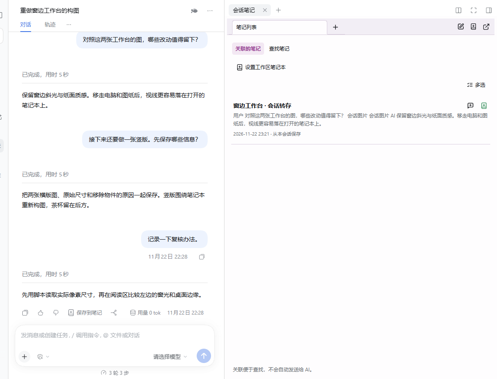
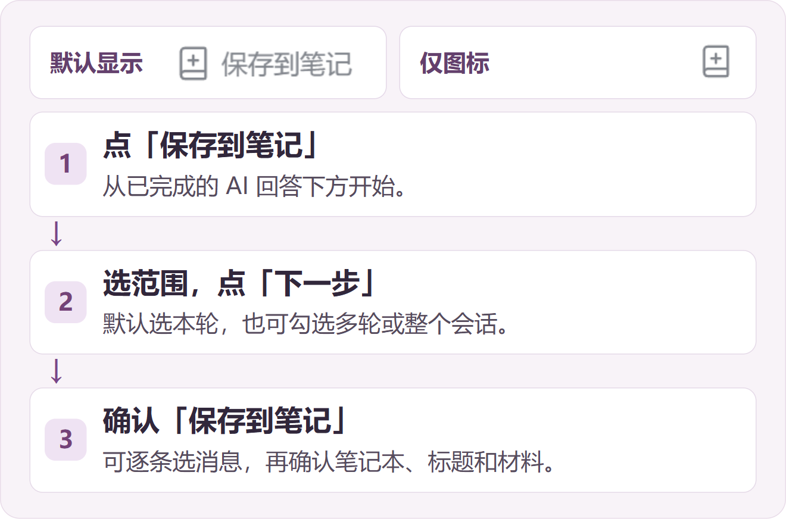
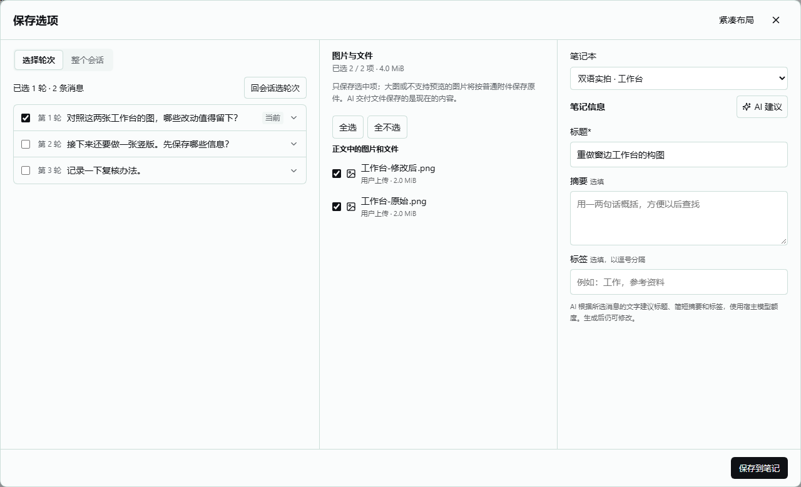
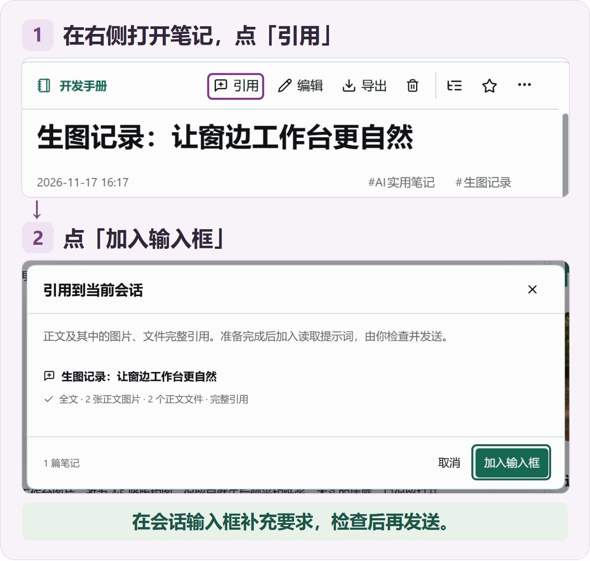
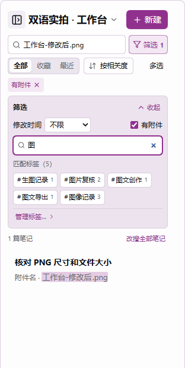
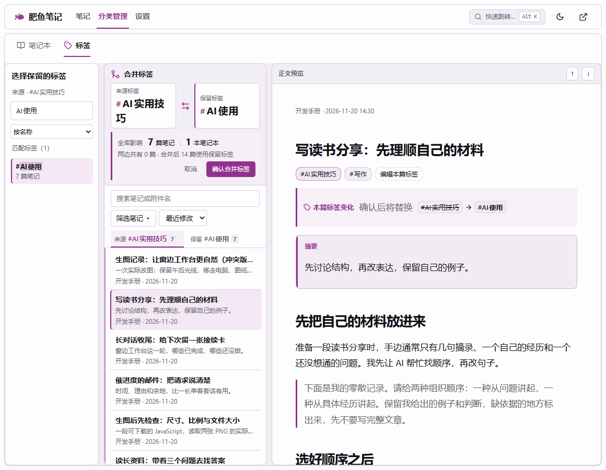
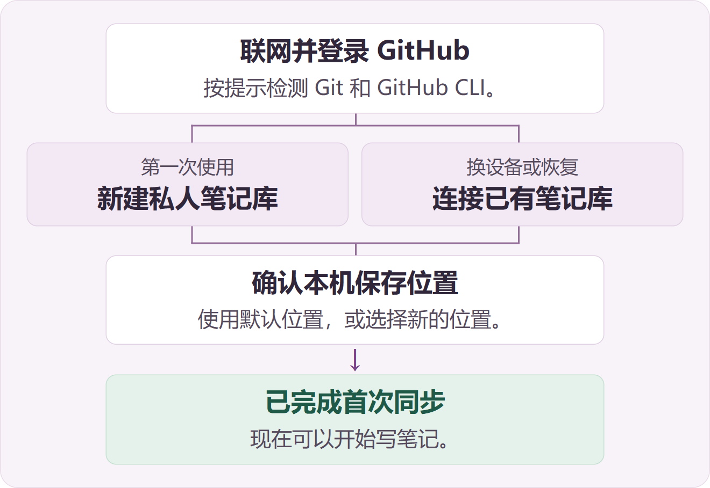
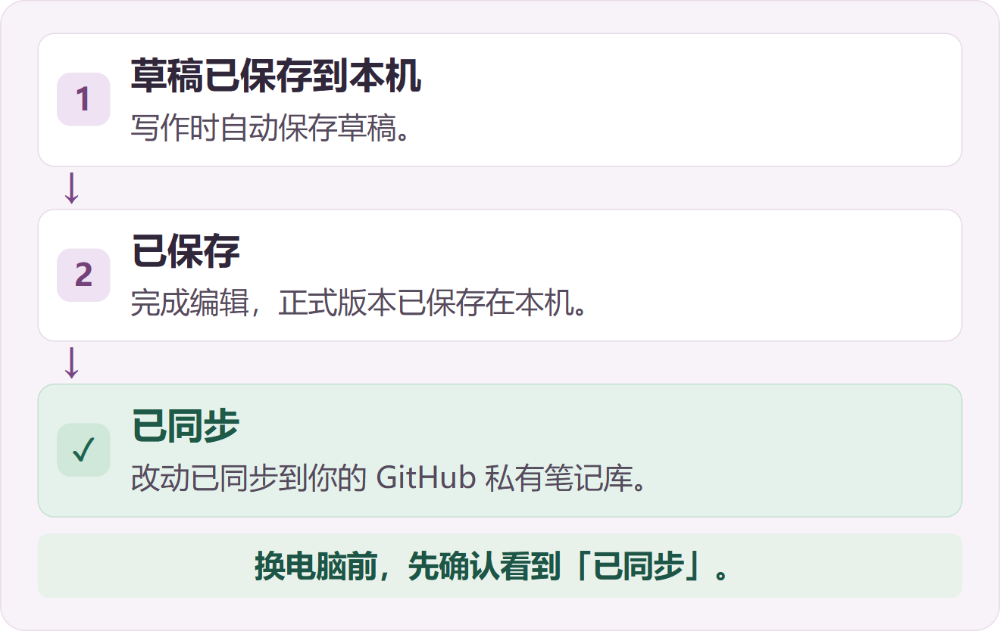
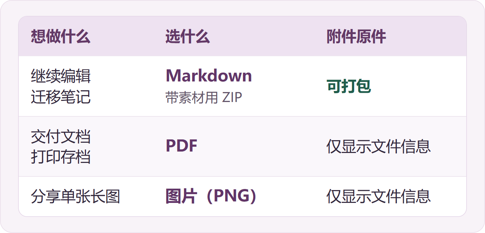

# 肥鱼笔记使用说明

[English](user-guide.en.md)

肥鱼笔记跟随 DSH 的界面语言。可以在 DSH「设置 → 通用设置 → 语言」切换简体中文和英文。笔记和会话原文采用其原有语言。

在 DSH 会话里，**点顶部小鱼打开「会话笔记」**，或点 **AI 回答下方的「保存到笔记」**。边聊边查资料，有用的问答也可以留到下次继续用。

[保存问答](#保存会话里的问答) · [边聊边用笔记](#在会话侧栏使用笔记) · [主界面](#写笔记与找笔记) · [整理标签](#整理笔记本与标签) · [首次设置](#首次设置) · [保存与同步](#保存与同步) · [导出](#导出与迁移)

## 保存会话里的问答

例如，想留住一轮改图建议，点**已完成的 AI 回答下方**的「保存到笔记」。默认选中本轮问答。开启「仅图标」的用户，找同一排的书本加号。

点 **「下一步」** 打开「保存选项」。宽窗从左到右显示轮次和消息、图片与文件、笔记信息。窄窗可以点标题栏的 **「展开布局」**，也可以在紧凑布局中单独核对范围和文件。切换布局会保留选择与已填内容。

选好笔记本和要保留的内容，确认预填的会话标题。你可以手填摘要和标签，也可以点 **「AI 建议」**，让模型根据所选消息的文字建议标题、摘要和标签。最后点 **「保存到笔记」**。

## 在会话侧栏使用笔记

点会话标题栏的小鱼，右侧就会打开 **「会话笔记」**。这段会话转存的资料会自动出现在 **「关联的笔记」**，条目会标记「从本会话保存」。想找库里的其他资料，切到 **「查找笔记」**。打开一篇后，点左上角返回，或点标签栏末尾的「+」打开 **「笔记列表」**，继续刚才的查找。

想让 AI 参考刚才保存的记录，在侧栏打开那篇笔记，点 **「引用 → 加入输入框」**。接着在输入框补一句「按这份记录继续讨论竖版构图」，检查后手动发送。仅把笔记关联到会话时，它会出现在侧栏供你查阅。

## 写笔记与找笔记

- **写笔记**　点「新建笔记」，或在已有笔记上点「编辑」。
- **找笔记**　可以先在「全部笔记」里搜索，也可以先选笔记本。输入记得的词或附件名，例如 `配图提示词.md`。想缩小范围时，点搜索框旁的筛选按钮，选择标签、修改时间或「有附件」。点带正文片段的结果，可直接跳到原句。

常常在几篇笔记之间来回看时，可以用阅读标签切换和拖动排序。标签栏末尾的「+」会打开概览，从最近打开或最近修改的笔记继续阅读。

## 整理笔记本与标签

从顶栏打开 **「分类管理」**，选择「笔记本」或「标签」。图中正在核对把「AI实用技巧」合并到「AI使用」的影响。先选「AI实用技巧」，点「合并」，再查找要保留的「AI使用」。

确认前可以核对全库影响，点击中间列表里的笔记，在右侧看到正文与标签会怎样变化。改名、合并和移除操作只更改标签。参见[标签管理](user-guide-reference.zh.md#标签管理)。

## 首次设置

首次连接要联网。按引导登录 GitHub，第一次用选「新建私人笔记库」，换设备用原账号「连接已有笔记库」。确认本机保存位置后，等首次同步完成即可开始写。安装命令和目录选择见 [安装与升级](../README.md#安装与升级) 与 [首次设置细节](user-guide-reference.zh.md#首次设置)。

## 保存与同步

首次同步完成后，离线也能写，联网后会继续同步。**换电脑前，先确认顶部同步状态为「已同步」。** 想手动检查，可到「设置 → 同步与存储」点「立即同步」。

## 导出与迁移

**单篇**在阅读工具栏点「导出」。要一起带走图片和附件原件，选 Markdown 并勾选所需材料。**整本或整库**从笔记列表底部的「导入 / 导出」操作。

## 按需查阅

[安装、升级与卸载](user-guide-reference.zh.md#安装升级与卸载) · [可离线阅读的用户手册](user-guide-reference.zh.md#用户手册) · [备份与恢复](user-guide-reference.zh.md#备份与恢复) · [问题反馈](user-guide-reference.zh.md#限制与问题反馈)

[外观、阅读与资料区](user-guide-reference.zh.md#外观阅读与资料区) · [三栏与独立窗口](user-guide-reference.zh.md#三栏与独立窗口) · [查找、整理与复用](user-guide-reference.zh.md#查找整理与复用) · [章节目录](user-guide-reference.zh.md#章节目录) · [日常操作](user-guide-reference.zh.md#日常操作)

[图片与附件](user-guide-reference.zh.md#图片正文文件与补充附件) · [导入与整库导出](user-guide-reference.zh.md#导入整库导出与附件) · [笔记本管理](user-guide-reference.zh.md#笔记本管理) · [标签管理](user-guide-reference.zh.md#标签管理) · [回收站](user-guide-reference.zh.md#多选和清空回收站) · [会话侧栏设置](user-guide-reference.zh.md#工作区笔记本设置与取消操作)

适用 **0.11.1**。见 [详细操作参考](user-guide-reference.zh.md) 和 [版本说明](releases/0.11.1/release-notes.md)。使用 0.10.0 时，可查看 [0.10.0 使用说明](https://github.com/StarWind97/dsh-fatfish-notes/blob/v0.10.0/docs/user-guide.zh.md)。
